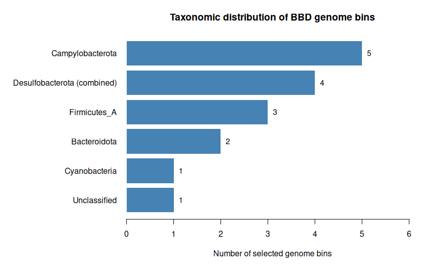
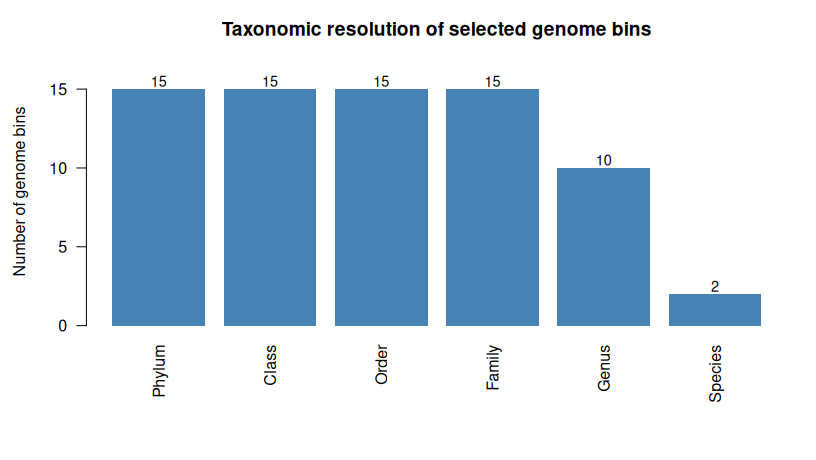

BBD Metagenome: Taxonomy
================
Akshay Chaitanya Talachintala
2026-11-05

## 4. Taxonomic Classification of Metagenome-Assembled Genomes

### 4.1 Research Context and Objectives

Black band disease (BBD) is associated with a complex microbial mat that
develops across affected coral tissue. The microbial community can
include organisms with different metabolic capabilities, potentially
contributing to the chemical and biological conditions within the mat.
Taxonomic classification provides a framework for identifying the
organisms represented in the recovered genomic material, but does not
independently establish their ecological functions or contributions to
disease.

This analysis examined genome bins reconstructed from nanopore
sequencing data obtained from BBD lesions on *Acropora hyacinthus* at
Orpheus Island, Queensland, Australia. The objective was to classify the
selected bacterial genome bins using the Genome Taxonomy Database
Toolkit (GTDB-Tk) and provide a taxonomic basis for subsequent gene
annotation and metabolic pathway analysis.

The analysis addressed three questions:

1.  Which bacterial lineages are represented among the selected genome
    bins?
2.  Does the recovered genomic material include taxa associated with BBD
    microbial communities?
3.  What potential biological questions emerge from these assignments,
    and what cannot be concluded from taxonomy alone?

### 4.2 Scientific Background

#### 4.2.1 Genome-resolved metagenomics

Metagenomic sequencing captures genetic material from multiple organisms
within an environmental sample. Assembly reconstructs longer DNA
sequences from reads, and genome binning groups assembled contigs into
candidate microbial genomes. These reconstructions are commonly
described as metagenome-assembled genomes (MAGs), although completeness
and contamination can vary considerably.

Genome-resolved approaches allow taxonomic assignments to be linked with
predicted gene content. However, the quality of recovered genomes and
the availability of suitable reference sequences influence the
reliability and resolution of subsequent analyses.

#### 4.2.2 Genome-based taxonomic classification

GTDB-Tk uses conserved marker genes and phylogenetic placement against
the Genome Taxonomy Database to classify bacterial and archaeal genomes.
Depending on genome quality and reference representation, assignments
can be resolved to different taxonomic ranks. GTDB nomenclature can
include database-specific names and suffixes, which are retained here as
reported.

Taxonomic identity is not direct evidence of metabolic activity, gene
expression, organism abundance, or causal involvement in disease.

### 4.3 Methods

#### 4.3.1 Selection of genome bins

The preceding CheckM assessment evaluated **77 candidate genome bins**:
76 produced by MetaBAT2 and the separately extracted largest assembled
contig, `contig_134`. Following the workshop procedure, bins with
estimated completeness **greater than 15%** were retained. This yielded
**16 bins** (approximately **20.8%** of those assessed), recorded in
`checkm/bbd_topbins.txt`.

The threshold was used to retain candidates for further investigation,
not to define all 16 as high-quality MAGs. Some retained bins were
substantially incomplete.

#### 4.3.2 Preparing the GTDB-Tk input directory

The following commands were executed from `~/Beneath-the-band/gtdbtk`.
The Bash snippets document the workflow; they are not rerun when this
report is knitted.

``` bash
cd ~/Beneath-the-band/gtdbtk

while read bin; do
  echo "$bin"
done < ../checkm/bbd_topbins.txt
```

The corresponding genome FASTA paths were checked before copying the
files:

``` bash
while read bin; do
  echo "../metabat/bins_bbd/${bin}.fa"
done < ../checkm/bbd_topbins.txt
```

``` bash
mkdir -p genomes

while read bin; do
  cp "../metabat/bins_bbd/${bin}.fa" genomes/
done < ../checkm/bbd_topbins.txt

ls genomes
ls genomes/*.fa | wc -l
```

The input directory contained **16 FASTA files**.

#### 4.3.3 GTDB-Tk classification workflow

GTDB-Tk was run on the university’s SLURM computing environment using a
container and the GTDB reference database mounted from
`/pvol/data/mg/gtdbtkdata/release207_v2/`.

The following script was saved as `gtdbtk/run_gtdbtk.sh`:

``` bash
#!/bin/bash
#SBATCH --time=120
#SBATCH --cpus-per-task=2 --mem=56gb

echo "Starting gtdbtk in $(pwd) at $(date)"

shopt -s expand_aliases

alias gtdbtk='apptainer run -B /pvol:/pvol,/pvol/data/mg/gtdbtkdata/release207_v2/:/refdata /pvol/data/sif/gtdbtk.sif'

gtdbtk classify_wf \
  -x fa \
  --cpus 2 \
  --genome_dir genomes \
  --out_dir out \
  --skip_ani_screen

echo "Finished gtdbtk in $(pwd) at $(date)"
```

The script requested **two CPU cores**, **56 GB of memory**, and a
**120-minute time limit**.

The `--skip_ani_screen` option skipped the initial average nucleotide
identity (ANI) screening stage; it does not imply that every subsequent
classification step excludes ANI-related information.

#### 4.3.4 Job submission and monitoring

``` bash
sbatch run_gtdbtk.sh

squeue -j 511

sacct -j 511 \
  --format=JobID,State,Elapsed,MaxRSS

tail -n 25 slurm-511.out
```

The submitted job was assigned SLURM ID **511**. The run proceeded
through phylogenetic placement and was subsequently reported as
**COMPLETED**.

#### 4.3.5 Retrieving classification results

``` bash
ls -lh out/gtdbtk.bac120.summary.tsv

cp out/gtdbtk.bac120.summary.tsv .

cut -f1,2 gtdbtk.bac120.summary.tsv

awk 'NR>1 {n++} END {print "Genomes in summary:", n}' \
  gtdbtk.bac120.summary.tsv
```

The bacterial summary contained **16 genome entries**, matching the
selected input set. Not every entry received a resolved phylum
assignment.

### 4.4 Results

#### 4.4.1 Overview of taxonomic recovery

GTDB-Tk produced summary records for all **16** selected genome bins.
**Fifteen** bins received a bacterial phylum assignment, while
`metabat.70` remained unclassified at the phylum level.

The resolved bins were distributed across Campylobacterota,
Desulfobacterota, Desulfobacterota_I, Firmicutes_A, Bacteroidota, and
Cyanobacteriota.

These results describe the taxonomic composition of the **selected
genome bins**, not the relative abundance of microorganisms in the
original BBD mat.

#### 4.4.2 Importing and summarising the GTDB-Tk output

The following chunk reads the actual GTDB-Tk summary and constructs the
tables used in both figures.

It deliberately stops with an informative error if the file is absent or
does not contain the expected columns.

``` r
# Knit this Rmd from the Beneath-the-band project root.
input_file <- "gtdbtk/gtdbtk.bac120.summary.tsv"

if (!file.exists(input_file)) {
  stop(
    "Cannot find ", input_file,
    ". Set the knit working directory to ~/Beneath-the-band, ",
    "or check that the GTDB-Tk summary has been copied there."
  )
}

taxonomy <- read.delim(
  input_file,
  sep = "\t",
  header = TRUE,
  check.names = FALSE,
  stringsAsFactors = FALSE,
  quote = "",
  comment.char = ""
)

required_columns <- c("user_genome", "classification")

if (!all(required_columns %in% names(taxonomy))) {
  stop(
    "GTDB-Tk file is missing required columns: ",
    paste(
      setdiff(required_columns, names(taxonomy)),
      collapse = ", "
    )
  )
}

# Extract a taxonomic rank, retaining GTDB-specific
# names and suffixes.
extract_rank <- function(classification, prefix) {

  vapply(
    strsplit(classification, ";", fixed = TRUE),
    function(parts) {

      item <- parts[startsWith(parts, prefix)]

      if (length(item) == 0L) {
        return(NA_character_)
      }

      value <- substring(
        item[1],
        nchar(prefix) + 1L
      )

      if (!nzchar(value)) {
        NA_character_
      } else {
        value
      }
    },
    character(1)
  )
}

taxonomy_summary <- data.frame(
  Genome = taxonomy$user_genome,
  Phylum = extract_rank(taxonomy$classification, "p__"),
  Class = extract_rank(taxonomy$classification, "c__"),
  Order = extract_rank(taxonomy$classification, "o__"),
  Family = extract_rank(taxonomy$classification, "f__"),
  Genus = extract_rank(taxonomy$classification, "g__"),
  Species = extract_rank(taxonomy$classification, "s__"),
  stringsAsFactors = FALSE
)

# Use "Unclassified" for empty or unresolved ranks
# in the display table.
rank_columns <- c(
  "Phylum", "Class", "Order",
  "Family", "Genus", "Species"
)

for (column in rank_columns) {

  missing_rank <- is.na(taxonomy_summary[[column]]) |
    !nzchar(trimws(taxonomy_summary[[column]]))

  taxonomy_summary[[column]][missing_rank] <- "Unclassified"
}

stopifnot(nrow(taxonomy_summary) == 16L)

knitr::kable(
  taxonomy_summary[
    , c("Genome", "Phylum", "Genus", "Species")
  ],
  caption = paste(
    "GTDB-Tk assignments for the 16 selected",
    "BBD genome bins. Unresolved ranks are",
    "labelled Unclassified."
  )
)
```

| Genome     | Phylum             | Genus              | Species                   |
|:-----------|:-------------------|:-------------------|:--------------------------|
| contig_134 | Bacteroidota       | UBA2561            | UBA2561 sp002340355       |
| metabat.10 | Campylobacterota   | Halarcobacter      | Unclassified              |
| metabat.18 | Campylobacterota   | Halarcobacter      | Unclassified              |
| metabat.22 | Campylobacterota   | Poseidonibacter    | Unclassified              |
| metabat.3  | Campylobacterota   | Halarcobacter      | Unclassified              |
| metabat.32 | Firmicutes_A       | Unclassified       | Unclassified              |
| metabat.36 | Firmicutes_A       | Unclassified       | Unclassified              |
| metabat.37 | Desulfobacterota   | Unclassified       | Unclassified              |
| metabat.45 | Cyanobacteria      | Roseofilum         | Roseofilum reptotaenium_A |
| metabat.50 | Desulfobacterota   | Unclassified       | Unclassified              |
| metabat.56 | Desulfobacterota_I | Maridesulfovibrio  | Unclassified              |
| metabat.60 | Firmicutes_A       | JABXKX01           | Unclassified              |
| metabat.70 | Unclassified       | Unclassified       | Unclassified              |
| metabat.71 | Campylobacterota   | Sulfurospirillum_A | Unclassified              |
| metabat.76 | Bacteroidota       | DT-34              | Unclassified              |
| metabat.9  | Desulfobacterota   | Unclassified       | Unclassified              |

GTDB-Tk assignments for the 16 selected BBD genome bins. Unresolved
ranks are labelled Unclassified.

The table is generated directly from the GTDB-Tk classification file
rather than manually transcribed taxonomic names.

#### 4.4.3 Distribution across bacterial phyla

**Campylobacterota** accounted for **five** bins.

**Desulfobacterota** and **Desulfobacterota_I** accounted for **four
bins combined** (three and one, respectively).

Three bins were assigned to **Firmicutes_A**, two to **Bacteroidota**,
and one to **Cyanobacteriota**.

One bin remained unclassified at phylum level.

The figure combines the two Desulfobacterota labels **for display
only**; the original GTDB assignments remain distinct in the
classification table.

``` r
plot_data <- taxonomy_summary

plot_data$Phylum_group <- plot_data$Phylum

plot_data$Phylum_group[
  plot_data$Phylum_group %in%
    c("Desulfobacterota", "Desulfobacterota_I")
] <- "Desulfobacterota (combined)"

counts <- sort(
  table(plot_data$Phylum_group),
  decreasing = TRUE
)

op <- par(mar = c(5, 13, 3.5, 2))

positions <- barplot(
  rev(counts),
  horiz = TRUE,
  las = 1,
  xlim = c(0, max(counts) + 1.2),
  col = "steelblue",
  border = NA,
  xlab = "Number of selected genome bins",
  main = "Taxonomic distribution of BBD genome bins"
)

text(
  x = rev(as.numeric(counts)) + 0.15,
  y = positions,
  labels = rev(as.numeric(counts)),
  cex = 0.95
)
```

<div class="figure" style="text-align: center">


<p class="caption">

Number of selected BBD genome bins in each GTDB phylum group.
Desulfobacterota and Desulfobacterota_I are combined for visualisation
only. Bin counts are not organism abundances.
</p>

</div>

``` r
par(op)
```

#### 4.4.4 Resolution of taxonomic assignments

GTDB-Tk assignments varied in their taxonomic resolution.

The figure below counts how many of the 16 bins had a non-empty
assignment at each rank.

This is a **description of the GTDB-Tk output**, not a validation of the
biological accuracy of every assignment.

``` r
rank_columns <- c(
  "Phylum", "Class", "Order",
  "Family", "Genus", "Species"
)

resolved <- vapply(
  taxonomy_summary[rank_columns],
  function(x) sum(x != "Unclassified"),
  integer(1)
)

op <- par(mar = c(7, 4.5, 3, 1.5))

positions <- barplot(
  resolved,
  col = "steelblue",
  border = NA,
  ylim = c(0, 17),
  ylab = "Number of genome bins",
  main = "Taxonomic resolution of selected genome bins",
  las = 2
)

text(
  positions,
  resolved + 0.5,
  labels = resolved,
  cex = 0.9
)
```

<div class="figure" style="text-align: center">


<p class="caption">

Number of selected genome bins with a resolved GTDB-Tk label at each
taxonomic rank. The figure is calculated directly from the GTDB-Tk
summary.
</p>

</div>

``` r
par(op)
```

#### 4.4.5 Recovery of a *Roseofilum*-classified genome

One of the most informative assignments was for `metabat.45`.

GTDB-Tk classified this bin within **Cyanobacteriota**, genus
***Roseofilum***, with the species designation ***Roseofilum
reptotaenium_A***.

The `_A` suffix is part of the reported GTDB designation and is retained
rather than silently replaced with a conventional species name.

The exact assignment can be inspected from the original output:

``` bash
awk -F '\t' '$1=="metabat.45" {print $2}' \
  gtdbtk.bac120.summary.tsv
```

CheckM previously estimated `metabat.45` to have **97.56% completeness**
and **0.67% contamination**, making it a particularly informative
candidate for subsequent functional analysis.

The genus *Roseofilum* is relevant to BBD-associated microbial mats, but
its recovery here does not establish activity, abundance, or a causal
role in coral tissue degradation.

#### 4.4.6 Additional bacterial lineages

Several bins were assigned to **Campylobacterota**, including
classifications within *Halarcobacter*, *Poseidonibacter*, and
*Sulfurospirillum_A*.

Additional bins were assigned to **Desulfobacterota** and
**Desulfobacterota_I**, including a *Maridesulfovibrio* assignment.

These lineages provide candidates for investigating potential
sulfur-related or respiratory metabolic pathways in later annotation
stages; their functions cannot be assumed solely from their taxonomic
names.

Other bins were assigned to **Firmicutes_A** and **Bacteroidota**.

The separately extracted largest contig, `contig_134`, was classified
within Bacteroidota and assigned to genus **UBA2561**.

CheckM estimated this bin to have **97.62% completeness** and **1.64%
contamination**.

By contrast, `metabat.70` was reported as unclassified at phylum level,
demonstrating that inclusion in the GTDB-Tk output does not guarantee a
resolved assignment.

### 4.5 Discussion

#### 4.5.1 Taxonomic diversity in the selected genome set

The selected bins represent several bacterial lineages rather than a
single taxonomic group.

This is consistent with the complexity expected in a microbial mat, but
the 16 recovered bins are only a subset of genomic material that could
be assembled, binned, and retained using the workshop’s completeness
threshold.

The distribution of bins across phyla must not be interpreted as the
distribution of cells or sequence abundance in the original sample.

#### 4.5.2 Potential implications for microbial interactions

The recovery of a *Roseofilum*-classified genome alongside
Campylobacterota and Desulfobacterota-related bins motivates further
investigation of the community’s potential metabolic diversity.

BBD mats may contain steep gradients in light, oxygen, and reduced
chemical compounds, providing a rationale for examining genes associated
with different metabolic strategies.

However, these assignments do not demonstrate direct metabolic exchange,
spatial associations, or interactions between the recovered organisms.

Such conclusions would require additional functional, physiological, or
spatial evidence.

#### 4.5.3 Taxonomy and functional potential are not equivalent

GTDB-Tk establishes genome-based taxonomic relationships; it does not
independently establish which pathways are present, complete, expressed,
or active.

Even closely related organisms can differ in gene content and
physiology.

The next stages therefore examine predicted coding sequences and
metabolic pathways, while distinguishing genomic potential from measured
activity.

#### 4.5.4 Limitations and uncertainty

**Genome completeness:** The greater-than-15% threshold retained
substantially incomplete bins. Missing genomic regions can affect
taxonomic resolution and later pathway reconstruction.

**Reference representation:** GTDB-Tk assignments depend on available
reference genomes; poorly represented lineages may remain unresolved.

**Database naming:** GTDB uses genome-based nomenclature and
database-specific suffixes. These are preserved as reported, including
`Firmicutes_A`, `Desulfobacterota_I`, and *Roseofilum reptotaenium_A*.

**Recovery bias:** The selected bins do not constitute a complete census
of the original BBD community.

**Ecological interpretation:** Detecting a genome sequence does not
establish organism viability, relative abundance, gene expression, or
direct involvement in disease.

### 4.6 Conclusion

GTDB-Tk produced bacterial classification records for all **16** genome
bins selected from the BBD metagenomic assembly.

Fifteen bins were assigned to a phylum, spanning several bacterial
lineages, while one remained unclassified at that level.

The recovery of the relatively complete *Roseofilum*-classified
`metabat.45` bin provides a useful target for further investigation,
alongside additional lineages of potential biogeochemical interest.

The next stage uses **Prokka** to predict coding sequences and annotate
putative gene functions, establishing a foundation for subsequent
metabolic pathway reconstruction.

Taxonomic classification alone is not evidence of metabolic activity or
a causal role in BBD.

### 4.7 References

Chaumeil, P.-A., Mussig, A. J., Hugenholtz, P., & Parks, D. H. (2020).
GTDB-Tk: A toolkit to classify genomes with the Genome Taxonomy
Database. *Bioinformatics, 36*(6), 1925–1927.
<https://doi.org/10.1093/bioinformatics/btz848>

Parks, D. H., Chuvochina, M., Waite, D. W., Rinke, C., Skarshewski, A.,
Chaumeil, P.-A., & Hugenholtz, P. (2018). A standardized bacterial
taxonomy based on genome phylogeny substantially revises the tree of
life. *Nature Biotechnology, 36*, 996–1004.
<https://doi.org/10.1038/nbt.4229>
