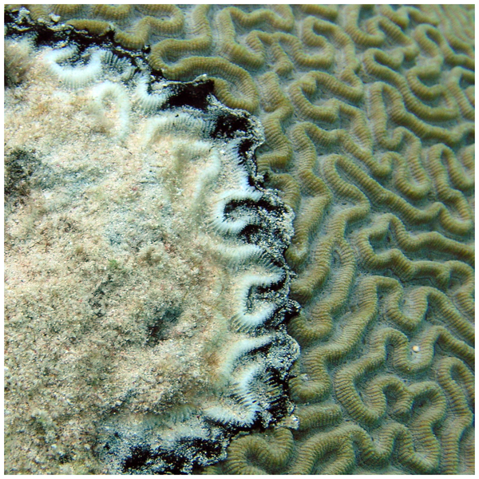
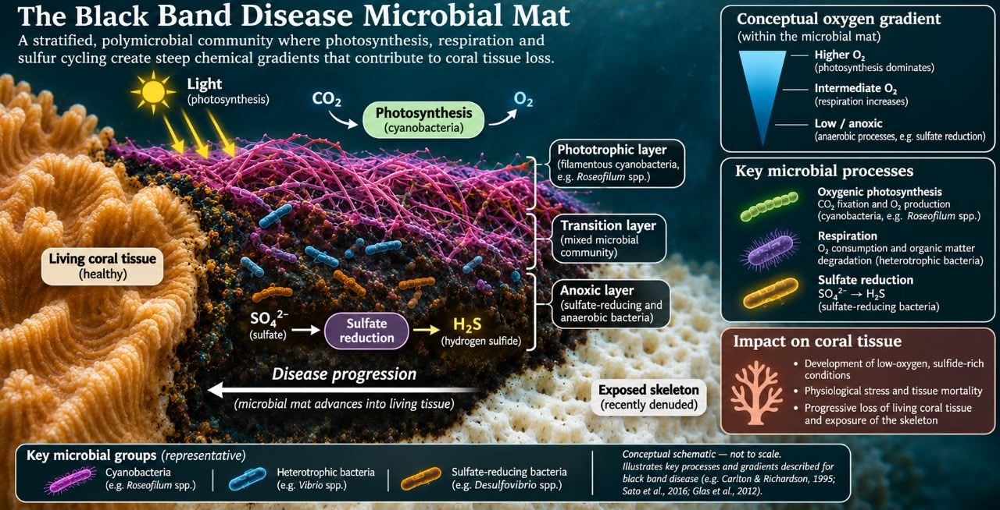

```{r setup, include=FALSE}
knitr::opts_chunk$set(echo = TRUE)
# Bash chunks are a record of commands you ran in the Terminal. Knitting shows
# them but doesn't run them again.
knitr::opts_hooks$set(engine = function(options) {
  if (options$engine == "bash") options$eval <- FALSE
  options
})
# Every step file has a chunk called setup, so allow the same label more than once
options(knitr.duplicate.label = "allow")
```

# Background

## Black band disease: a complex microbial infection

Black band disease (BBD) is a coral disease that shows a dark moving microbial mat. This mat moves across coral tissue leaving bare skeleton behind. Unlike infections caused by a pathogen Black band disease involves many different microbes that together break down the coral tissue. The disease can remove amounts of tissue and in the worst cases kill the coral colony as shown by studies such as Zimmer et al. (2014). Sato et al. (2016).

{width="85%"}

## Microbial interactions within the disease mat

The BBD microbial mat usually contains cyanobacteria, sulfate‑reducing bacteria sulfur‑oxidising bacteria and other heterotrophic microbes. Cyanobacteria, those from the genus *Roseofilum* play a key photosynthetic role in this community.. The mat also supports microbes with different metabolic needs creating a very organized microbial environment (Sato et al., 2016).

Photosynthesis can raise oxygen levels in the illuminated layers while microbial respiration pulls oxygen out. As a result steep oxygen gradients form inside the mat with deeper parts becoming oxygen‑free or anoxic. These conditions shift with light and switch between day and night (Carlton & Richardson 1995).

In oxygen‑free zones sulfate‑reducing microbes can produce hydrogen sulfide. The mix of oxygen and high sulfide near the coral‑mat border stresses the tissue and drives disease progression (Glas et al., 2012).

{width="100%"}

## Why investigate the genomes?

Although many researchers have explored the diversity and biogeochemical traits of BBD simply finding microbes does not show what each one can do or how it helps the disease.

Genome‑resolved metagenomics gives a chance to look at these questions by piecing together DNA from the environment. After we assemble the DNA and separate it into genomes we can check how complete each genome is, label its group and search for genes that link to specific metabolic tasks.

Long‑read sequencing can help finish genome regions that short reads miss. Mistakes in assembly missing pieces and uncertainty about what genes actually do can still be problems.

Crucially spotting a gene or a predicted pathway tells us what a microbe might be able to do. It does not prove that the gene is active or that the microbe is producing the compound in real life.

## Study aim and objectives

*Beneath the Band* looks at genome diversity and predicted metabolic functions in black band disease‑related metagenomic data from *Acropora hyacinthus* taken at Orpheus Island, Queensland, Australia.

**Research question:** What can genome‑resolved analysis reveal about the microbial diversity and potential metabolic functions linked to coral black band disease?

The study aims to:

- Assemble metagenomic sequences and reconstruct candidate microbial genomes.

- Evaluate how complete each genome bin is and how much contamination it has.

- Identify the main bacterial lineages shown by recovered genomes.

- Characterise the predicted protein‑coding genes and enzyme annotations.

- Investigate genomic clues for photosynthesis. Sulfur‑related metabolic pathways.

These analyses give a framework for understanding the potential of the recovered community and, for comparing it with earlier black band disease studies.


```{r table-styling, echo=FALSE, results='asis'}
cat('
<style>
table {
  border-collapse: collapse;
  width: 85%;
  margin: 20px 0 25px 0;
  font-size: 15px;
}

table th {
  background-color: #eaf1f5;
  color: #20395f;
  font-weight: 600;
  padding: 12px 18px;
  border-bottom: 2px solid #315d91;
  text-align: left;
}

table td {
  padding: 10px 18px;
  border-bottom: 1px solid #dce3e8;
}

table tbody tr:nth-child(even) {
  background-color: #f7f9fb;
}

table caption {
  caption-side: top;
  text-align: left;
  font-weight: 600;
  padding-bottom: 10px;
}
</style>
')
```


# Results

## 3.1 Assembly of metagenomes

Using Flye the metagenomic reads from the black band disease were assembled into 7,979 contigs covering a total of about 66.69 Mbp. The largest contig reached 4.71 Mbp in length. The assembly N50 was 12,985 bp (Table 1).

```{r assembly-table, echo=FALSE, results='asis'}
assembly_table <- data.frame(
  "Assembly metric" = c(
    "Number of contigs",
    "Total assembly length",
    "Largest contig",
    "Contig N50"
  ),
  "Value" = c(
    "7,979",
    "66,690,645 bp (66.69 Mbp)",
    "4,706,700 bp (4.71 Mbp)",
    "12,985 bp (12.99 kbp)"
  ),
  check.names = FALSE
)

knitr::kable(
  assembly_table,
  format = "html",
  caption = "Table 1. Summary statistics for the Flye metagenomic assembly."
)
```

The relatively low N50 value and the high number of contigs indicate that a large part of the metagenomic assembly remains broken into smaller pieces despite the presence of a contig that is several megabases long. Still the continuity of contigs does not reflect the quality of the reconstructed microbial genomes. To evaluate the completeness and contamination levels of genome bins CheckM was used, as described in Section 3.2.

## 3.2 Genome recovery and quality

Metagenomic binning with MetaBAT2 recovered seventy‑seven candidate genome bins. An additional large assembled contig, `contig_134` was kept separately for analysis. CheckM was used to estimate genome completeness and contamination and sixteen candidate genomes were chosen for taxonomic and functional investigation.

Two candidate genomes, `contig_134` and `metabat.45` showed high estimated completeness, 97.62% and 97.56% respectively and had relatively low contamination (Table 2). In comparison several other candidate genomes had lower completeness even though they showed little or no estimated contamination.

```{r checkm-table, echo=FALSE, results='asis'}
quality_table <- data.frame(
  "Genome candidate" = c(
    "contig_134",
    "metabat.45",
    "metabat.3",
    "metabat.18",
    "metabat.9"
  ),
  "Completeness (%)" = c(
    97.62, 97.56, 34.48, 30.28, 28.18
  ),
  "Contamination (%)" = c(
    1.64, 0.67, 0.00, 0.00, 0.13
  ),
  check.names = FALSE
)

knitr::kable(
  quality_table,
  format = "html",
  digits = 2,
  caption = "Table 2. CheckM quality estimates for five selected genome candidates."
)
```

### Genome quality visualisation

The completeness and contamination estimates for all sixteen selected candidate genomes are shown in Figure 3. This comparison lets complete candidate genomes be distinguished from more fragmented recoveries.

```{r checkm-quality, echo=FALSE, message=FALSE, warning=FALSE, fig.width=8, fig.height=5.5, fig.cap="Figure 3. Estimated completeness and contamination of 16 selected genome candidates based on CheckM analysis."}
library(ggplot2)

# Read CheckM output
lines <- readLines("checkm/checkm_results_bbd.txt")
lines <- lines[grepl("^\\s*(contig_|metabat\\.)", lines)]

# Split columns using multiple spaces
parts <- strsplit(trimws(lines), "\\s{2,}")

checkm <- data.frame(
  bin = sapply(parts, `[`, 1),
  completeness = as.numeric(
    sapply(parts, function(x) x[length(x) - 2])
  ),
  contamination = as.numeric(
    sapply(parts, function(x) x[length(x) - 1])
  )
)

# Retain the 16 selected genome candidates
selected <- scan(
  "checkm/bbd_topbins.txt",
  what = "character",
  quiet = TRUE
)

checkm <- subset(checkm, bin %in% selected)

stopifnot(nrow(checkm) == 16)

# Visualise genome quality
ggplot(checkm, aes(x = completeness, y = contamination)) +
  geom_point(size = 3, colour = "#257C91") +
  geom_text(
    data = subset(
      checkm,
      bin %in% c("contig_134", "metabat.45")
    ),
    aes(label = bin),
    vjust = -1,
    size = 3.5
  ) +
  labs(
    title = "Quality of recovered microbial genomes",
    x = "Estimated completeness (%)",
    y = "Estimated contamination (%)"
  ) +
  theme_minimal(base_size = 12)
```

The CheckM results reveal variation, in genome recovery. Although `contig_134` and `metabat.45` were recovered with estimated completeness, other selected candidate genomes represent considerably less complete genomic reconstructions.

Importantly low estimated contamination does not necessarily mean a complete candidate genome. For example `metabat.3` showed no estimated contamination but 34.48% completeness. These differences should be considered when interpreting assignments and predicted metabolic functions in subsequent analyses. \# Assembly

## 3.3 Taxonomic composition of genomes

Used GTDB‑Tk to classify the 16 chosen genome candidates in order to explore the microbial diversity that appears in the black band disease (BBD) metagenome. The results showed lineages at many taxonomic levels from species‑level labels all the way up to higher ranks that could not be resolved (see Table.3).

The recovered genomes are members of Bacteroidota and Campylobacterota. The complete candidate `contig_134` was placed in Bacteroidota within the family Bernardetiaceae and the genus UBA2561. In Campylobacterota two candidates, `metabat.10` and `metabat.18` belong to the genus *Halarcobacter* while `metabat.22` falls into *Poseidonibacter*. These assignments show that several different bacterial lineages are part of the community that causes the disease.

### Taxonomic assignments of genome candidates
```{r taxonomy-table, echo=FALSE, message=FALSE, warning=FALSE, results='asis'}
# Read GTDB-Tk classifications
taxonomy <- read.delim(
  "gtdbtk/gtdbtk.bac120.summary.tsv",
  sep = "\t",
  check.names = FALSE
)

# Extract individual taxonomic ranks
get_rank <- function(x, prefix) {
  ranks <- strsplit(x, ";", fixed = TRUE)

  vapply(ranks, function(parts) {
    matches <- parts[startsWith(parts, prefix)]

    if (length(matches) == 0) return("Unclassified")

    value <- substring(matches[1], 4)

    if (value == "") "Unclassified" else value
  }, character(1))
}

taxonomy$Phylum <- get_rank(taxonomy$classification, "p__")
taxonomy$Genus <- get_rank(taxonomy$classification, "g__")
taxonomy$Species <- get_rank(taxonomy$classification, "s__")

# Confirm all 16 candidates are present
stopifnot(nrow(taxonomy) == 16)

# Prepare taxonomic summary table
tax_table <- taxonomy[
  order(taxonomy$Phylum, taxonomy$user_genome),
  c("user_genome", "Phylum", "Genus", "Species")
]

names(tax_table)[1] <- "Genome candidate"

knitr::kable(
  tax_table,
  format = "html",
  caption = "Table 3. GTDB-Tk taxonomic assignments of the 16 selected genome candidates."
)
```

### Distribution of recovered lineages

We examined the phylum‑level distribution of the selected genome candidates (Figure.4). This gives a snapshot of the bacterial lineages that appear in the reconstructed genomes although the number of candidates does not equal the actual bacterial abundance in the original sample.

```{r taxonomy-figure, echo=FALSE, message=FALSE, warning=FALSE, fig.width=8, fig.height=5.5, fig.cap="Figure 4. Distribution of the 16 selected genome candidates across bacterial phyla based on GTDB-Tk classifications."}
library(ggplot2)

# Count recovered genome candidates per phylum
phylum_counts <- as.data.frame(
  table(taxonomy$Phylum)
)

names(phylum_counts) <- c("Phylum", "Genome_count")

# Create taxonomic distribution figure
ggplot(
  phylum_counts,
  aes(
    x = reorder(Phylum, Genome_count),
    y = Genome_count
  )
) +
  geom_col(
    fill = "#257C91",
    width = 0.65
  ) +
  geom_text(
    aes(label = Genome_count),
    hjust = -0.25,
    size = 3.8
  ) +
  coord_flip() +
  scale_y_continuous(
    breaks = seq(0, 16, 2),
    limits = c(0, max(phylum_counts$Genome_count) + 2)
  ) +
  labs(
    title = "Taxonomic diversity of recovered genomes",
    x = "Bacterial phylum",
    y = "Number of genome candidates"
  ) +
  theme_minimal(base_size = 12) +
  theme(
    panel.grid.major.y = element_blank()
  )
```

### resolution and biological relevance

```{r taxonomy-summary, echo=FALSE, results='asis'}
# Summarise classification resolution
species_count <- sum(taxonomy$Species != "Unclassified")
genus_count <- sum(taxonomy$Genus != "Unclassified")
phylum_count <- length(unique(taxonomy$Phylum))

cat(
  "Across the 16 genome candidates, GTDB-Tk identified ",
  phylum_count,
  " distinct phylum-level categories. ",
  genus_count,
  " candidates received genus-level assignments, while ",
  species_count,
  " were classified to species level. ",
  "The remaining candidates were resolved only to broader taxonomic ranks.\n\n",
  sep = ""
)

# Report relevant lineages only if present
cyanobacteria <- taxonomy[
  grepl("Cyanobacter", taxonomy$Phylum, ignore.case = TRUE),
]

sulfur_lineages <- taxonomy[
  grepl("Desulfobacter", taxonomy$Phylum, ignore.case = TRUE),
]

if (nrow(cyanobacteria) > 0) {
  cat(
    "Cyanobacterial lineages were represented among the recovered genomes, ",
    "including ",
    paste(cyanobacteria$user_genome, collapse = ", "),
    ". These candidates are particularly relevant to investigating ",
    "the photosynthetic component of the BBD microbial mat.\n\n",
    sep = ""
  )
}

if (nrow(sulfur_lineages) > 0) {
  cat(
    "Members of Desulfobacterota were also recovered, ",
    "including ",
    paste(sulfur_lineages$user_genome, collapse = ", "),
    ". Their taxonomic placement makes them relevant candidates ",
    "for subsequent investigation of sulfur-related metabolic potential.\n\n",
    sep = ""
  )
}
```

Overall the GTDB‑Tk classifications show that the selected genome candidates form a taxonomically diverse collection of bacteria that are associated with the BBD sample. These genome candidates are diverse. Differences in genome completeness and taxonomic resolution create uncertainty when interpreting assignments for genome candidates especially for highly incomplete bins. In addition taxonomic identity alone does not confirm activity, sulfate reduction or a direct role, in disease progression. Functional gene annotation and metabolic pathway reconstruction were therefore used to examine the biological capabilities of these bacteria.

## 3.4 Functional gene annotation

Functional gene annotation of the 16 selected genome candidates was carried out with Prokka to identify predicted protein‑coding sequences (CDS) and to give them gene functions. The functional gene annotation covered proteins that had known functions, proteins that had no specific functional assignments and genes that were linked to Enzyme Commission (EC) numbers.

To look at differences in annotation coverage, among the genomes the total numbers of predicted CDS, hypothetical proteins and EC‑annotated CDS were counted for each candidate (Table.4).

### Summary of predicted protein‑coding gene

```{r prokka-summary, echo=FALSE, message=FALSE, warning=FALSE, results='asis'}
# Use the 16 genome IDs confirmed in the GTDB-Tk results
bins <- taxonomy$user_genome

# Read and summarise Prokka annotation files
summarise_prokka <- function(bin) {

  file <- file.path("prokka", bin, paste0(bin, ".tsv"))

  genes <- read.delim(
    file,
    sep = "\t",
    check.names = FALSE,
    stringsAsFactors = FALSE
  )

  cds <- genes[genes$ftype == "CDS", ]

  hypothetical <- sum(
    trimws(tolower(cds$product)) == "hypothetical protein",
    na.rm = TRUE
  )

  ec_annotated <- sum(
    !is.na(cds$EC_number) &
      trimws(cds$EC_number) != "" &
      trimws(cds$EC_number) != "-",
    na.rm = TRUE
  )

  data.frame(
    Genome = bin,
    CDS = nrow(cds),
    Hypothetical = hypothetical,
    Annotated = nrow(cds) - hypothetical,
    EC_annotated = ec_annotated
  )
}

prokka_summary <- do.call(
  rbind,
  lapply(bins, summarise_prokka)
)

# Calculate percentage of hypothetical proteins
prokka_summary$Hypothetical_percent <- round(
  100 * prokka_summary$Hypothetical /
    prokka_summary$CDS,
  1
)

# Order by total CDS
prokka_summary <- prokka_summary[
  order(prokka_summary$CDS, decreasing = TRUE),
]

# Format table
gene_table <- prokka_summary[
  ,
  c(
    "Genome",
    "CDS",
    "Hypothetical",
    "Hypothetical_percent",
    "EC_annotated"
  )
]

names(gene_table) <- c(
  "Genome candidate",
  "Total CDS",
  "Hypothetical proteins",
  "Hypothetical (%)",
  "CDS with EC numbers"
)

knitr::kable(
  gene_table,
  format = "html",
  caption = "Table 4. Prokka functional annotation summary for the 16 selected genome candidates."
)
```

### Distribution of hypothetical proteins

The share of predicted coding sequences that were given a functional description changed from genome to genome. Figure 5 shows a comparison, between coding sequences annotated as proteins and coding sequences annotated with other functional descriptions giving a clear overview of how many coding sequences were annotated in each genome.

```{r prokka-figure, echo=FALSE, message=FALSE, warning=FALSE, fig.width=9, fig.height=7, fig.cap="Figure 5. Predicted protein-coding sequences classified as hypothetical proteins or other functional annotations across the 16 genome candidates."}
library(ggplot2)

# Convert summary into long format
plot_data <- rbind(
  data.frame(
    Genome = prokka_summary$Genome,
    Category = "Hypothetical proteins",
    Count = prokka_summary$Hypothetical
  ),
  data.frame(
    Genome = prokka_summary$Genome,
    Category = "Other annotations",
    Count = prokka_summary$Annotated
  )
)

# Keep genomes ordered by total CDS
plot_data$Genome <- factor(
  plot_data$Genome,
  levels = rev(prokka_summary$Genome)
)

ggplot(
  plot_data,
  aes(x = Genome, y = Count, fill = Category)
) +
  geom_col(width = 0.7) +
  coord_flip() +
  scale_fill_manual(
    values = c(
      "Hypothetical proteins" = "#8CB9C5",
      "Other annotations" = "#20395F"
    )
  ) +
  labs(
    title = "Functional annotation of recovered genomes",
    x = "Genome candidate",
    y = "Number of predicted CDS",
    fill = "Annotation category"
  ) +
  theme_minimal(base_size = 12) +
  theme(
    panel.grid.major.y = element_blank(),
    legend.position = "bottom"
  )
```

### Annotation coverage and enzyme assignments

```{r prokka-interpretation, echo=FALSE, results='asis'}
total_cds <- sum(prokka_summary$CDS)
total_hypothetical <- sum(prokka_summary$Hypothetical)
total_ec <- sum(prokka_summary$EC_annotated)

hypothetical_percentage <- round(
  100 * total_hypothetical / total_cds,
  1
)

cat(
  "Across the 16 selected genome candidates, Prokka predicted ",
  format(total_cds, big.mark = ","),
  " protein-coding sequences. Of these, ",
  format(total_hypothetical, big.mark = ","),
  " (", hypothetical_percentage,
  "%) were annotated as hypothetical proteins, while ",
  format(total_ec, big.mark = ","),
  " CDS received EC-number assignments.\n\n",
  sep = ""
)

# Report the previously identified cyanobacterial candidate
roseofilum <- prokka_summary[
  prokka_summary$Genome == "metabat.45",
]

if (nrow(roseofilum) == 1) {
  cat(
    "The genome candidate `metabat.45` contained ",
    format(roseofilum$CDS, big.mark = ","),
    " predicted CDS, including ",
    format(roseofilum$Hypothetical, big.mark = ","),
    " hypothetical proteins (",
    roseofilum$Hypothetical_percent,
    "%). This indicates that a substantial proportion of its ",
    "predicted protein-coding genes could not be assigned ",
    "specific functions through Prokka.\n\n",
    sep = ""
  )
}
```

The presence of EC-number assignments gives us a starting point for exploring enzyme-driven metabolic processes.. It's important to remember that functional annotation is based on sequence similarity and reference databases not on direct lab tests showing enzyme activity. Also if the genome recovery is not complete some genes and metabolic pathways may be missing in the less complete microbial candidates flagged by CheckM.

These annotated gene sets were then used in MinPath to reconstruct metabolic pathways. This helped us explore photosynthetic functions and sulfur-related activities, in the BBD microbial community.

## 3.5 Metabolic pathway reconstruction

Metabolic pathway reconstruction was carried out with MinPath to explore the functional capabilities of the recovered microbial genomes. Enzyme Commission (EC) annotations produced by Prokka were employed to spot candidate metabolic pathways those linked to photosynthesis and sulfur-associated processes that are important for black band disease (BBD).

MinPath gives two pieces of information: the count of enzyme families that belong to a pathway and whether that pathway remains in the reconstruction. By looking at both pieces metabolic pathway reconstruction can separate pathway predictions that have strong support, from those that only have one or a few enzyme families and are therefore weaker.

### Photosynthetic and sulfur-associated pathways

```{r metabolic-table, echo=FALSE, message=FALSE, warning=FALSE, results='asis'}
# Read all MinPath reports
report_files <- list.files(
  "minpath",
  pattern = "\\.ec\\.report$",
  full.names = TRUE
)

# Extract pathway records
read_minpath <- function(file) {
  lines <- readLines(file, warn = FALSE)
  lines <- lines[grepl("^path ", lines)]

  if (length(lines) == 0) return(NULL)

  extract_field <- function(line, field) {
    pattern <- paste0(".*\\b", field, "\\s+(\\S+).*")
    if (!grepl(paste0("\\b", field, "\\s+"), line)) {
      return(NA_character_)
    }
    sub(pattern, "\\1", line)
  }

  data.frame(
    Genome = sub("\\.ec\\.report$", "", basename(file)),
    Pathway = vapply(lines, function(x) {
      strsplit(x, "\\s+")[[1]][2]
    }, character(1)),
    Selected = vapply(lines, extract_field, character(1),
                      field = "minpath"),
    Families_total = vapply(lines, extract_field, character(1),
                            field = "fam0"),
    Families_found = vapply(lines, extract_field, character(1),
                            field = "fam-found"),
    Description = sub("^.*\\bname\\s+", "", lines),
    stringsAsFactors = FALSE
  )
}

pathways <- do.call(
  rbind,
  lapply(report_files, read_minpath)
)

pathways$Families_total <- as.numeric(pathways$Families_total)
pathways$Families_found <- as.numeric(pathways$Families_found)

# Focus on the two pathways investigated
focus <- pathways[
  pathways$Pathway %in% c("PWY-101", "PWY-5360"),
]

focus <- focus[
  order(focus$Pathway, focus$Genome),
]

focus$Support <- paste0(
  focus$Families_found,
  "/",
  focus$Families_total
)

focus$MinPath_selected <- ifelse(
  focus$Selected == "1", "Yes", "No"
)

table5 <- focus[
  ,
  c(
    "Genome",
    "Pathway",
    "Support",
    "MinPath_selected"
  )
]

names(table5) <- c(
  "Genome candidate",
  "Pathway ID",
  "Enzyme-family support",
  "MinPath selected"
)

knitr::kable(
  table5,
  format = "html",
  caption = "Table 5. MinPath evidence for photosynthesis light reactions (PWY-101) and tetrathionate reduction (PWY-5360) among selected genome candidates."
)
```

Photosynthesis light reactions (PWY-101) were found in four genome candidates as shown in Table 5. The best evidence came from `metabat.45` where all four enzyme families that belong to the reference pathway were seen and MinPath chose this pathway. By contrast `metabat.32` was chosen even though it had one of the four enzyme families. `Contig_134` and `metabat.50` also had one of the four families but MinPath did not choose them.

The tetrathionate reduction superpathway (PWY-5360) was found in `metabat.18` where one of the three enzyme families was seen.. Minpath did not pick this pathway showing that the evidence was not enough to add it to the simplest reconstruction.

### Visualisation of metabolic pathway evidence

Figure 6 shows how many enzyme families were detected for the two pathways, in the genome candidates where they were reported. This picture gives a view of predicted metabolic potential, not the activity that has been measured in the lab.

```{r metabolic-figure, echo=FALSE, message=FALSE, warning=FALSE, fig.width=9, fig.height=5.5, fig.cap="Figure 6. Enzyme-family support for photosynthesis light reactions (PWY-101) and tetrathionate reduction (PWY-5360) among recovered genome candidates. Labels indicate detected/reference enzyme families; outlined tiles indicate pathways selected by MinPath."}
library(ggplot2)

focus$Support_fraction <- with(
  focus,
  Families_found / Families_total
)

focus$Pathway_label <- ifelse(
  focus$Pathway == "PWY-101",
  "Photosynthesis light reactions",
  "Tetrathionate reduction"
)

focus$Genome <- factor(
  focus$Genome,
  levels = rev(unique(focus$Genome))
)

ggplot(
  focus,
  aes(
    x = Pathway_label,
    y = Genome,
    fill = Support_fraction
  )
) +
  geom_tile(
    colour = "white",
    linewidth = 1,
    width = 0.95,
    height = 0.85
  ) +
  geom_tile(
    data = subset(focus, Selected == "1"),
    fill = NA,
    colour = "#20395F",
    linewidth = 1.3,
    width = 0.95,
    height = 0.85
  ) +
  geom_text(
    aes(label = Support),
    size = 4
  ) +
  scale_fill_gradient(
    low = "#EAF1F5",
    high = "#257C91",
    limits = c(0, 1),
    name = "Enzyme-family\nsupport"
  ) +
  labs(
    title = "Metabolic pathway evidence in recovered genomes",
    x = "Predicted metabolic pathway",
    y = "Genome candidate"
  ) +
  theme_minimal(base_size = 12) +
  theme(
    panel.grid = element_blank(),
    axis.text.x = element_text(angle = 15, hjust = 1)
  )
```

# Discussion

## 4.1 Metagenome assembly and genome recovery

The genome-resolved analysis of the black band disease (BBD) microbial community showed differences in how continuous the assembly was and how many genomes we could recover. The Flye assembly produced 7,979 contigs that together cover 66.69.Mbp. The low N50 value of 12,985.bp means the metagenome is still very broken into pieces. Still we were able to recover one contig that's 4.71.Mbp long and two genome candidates that are about 97.6.% complete. This proves that we can pull out continuous genomic sequences from the long‑read data.

The different completeness scores of the 16 chosen candidates show a problem with metagenomic assembly. `Contig_134`. Metabat.45` are highly complete and have little contamination but many other candidates hold much less of their expected genome. These differences could come from sequencing coverage, how complex the community is, the nature of the genomes themselves or how well the assembly and binning tools work. The data we have now do not tell us which of these reasons is the cause.

Genome completeness matters a lot when we try to understand metabolism. If a gene or pathway is missing from a genome that does not automatically mean that the organism that owns that genome does not have that ability. Therefore we can trust conclusions from highly complete candidates more but we must be careful when a bin is incomplete and shows missing genes.

## 4.2 Microbial diversity and the significance of Roseofilum

The GTDB‑Tk classifications showed different bacterial lineages in the BBD metagenome we recovered which matches the idea that this disease involves many microbes. The complete candidate `contig_134` belongs to Bacteroidota while other candidates belong to Campylobacterota and include the genera *Halarcobacter* and *Poseidonibacter*. These results mean that the sample holds genomes from groups that are quite different from each other.

A key discovery was the recovery of `metabat.45` which GTDB‑Tk classifies as *Roseofilum reptotaenium_A*. This candidate is 97.56.% complete and has only 0.67.% contamination giving us a fairly complete genome of a cyanobacterium that is closely linked to BBD.

This result is very relevant to the study by Sato et al. (2017) Which found that the cyanobacterial bin called Cya2 is *Roseofilum reptotaenium* based on 16S data. The match between the *Roseofilum* genomes we recovered and the ones in that study shows how important this genus is in BBD communities. Still the GTDB label *R. Reptotaenium_A* is not automatically the same as the species name in the paper unless we compare the genomes directly.

Other bacterial lineages we found might show the ecological interactions inside the disease mat. However just knowing the taxonomy does not tell us whether these organisms help the disease get worse take part in metabolic tasks or simply live in the surrounding community.

## 4.3 Photosynthetic potential and microbial interactions

When we annotated functions and rebuilt pathways we found proof that the cyanobacterial genome is biologically important. In `metabat.45` the tool MinPath found all four enzyme families that belong to the photosynthesis light‑reaction pathway (PWY‑101). That pathway stayed in the reconstruction. This was the evidence for photosynthesis among all the genome candidates we looked at.

This finding matches what we already know about photosynthesis in BBD mats. When the cyanobacteria photosynthesize they create carbon and change the oxygen level nearby which can change the metabolic world that other microbes live in.

Sato et al. (2017) Also found photosynthesis genes. Studied how they are expressed while BBD lesions grow. By combining metatranscriptomic data they linked the expression of cyanobacterial genes to the processes that happen in the disease.

Our study used only genomic DNA and computer predictions of pathways. Even though we found genes for photosynthesis that does not prove the genes were active or that photosynthesis was happening when we took the samples.

Also the pathway chosen by MinPath must be looked at together with the enzyme families it relies on. For instance `metabat.32` was marked as having the PWY‑101 pathway even though it contains one of the four key enzyme families. This shows that we must check the evidence behind a pathway not just say it exists or not.

## 4.4 Comparison with the published Illumina metagenome

Sato et al. (2017) Looked at how cyanobacterial patches turn into BBD lesions on *Montipora hispida* at Pelorus Island using Illumina reads, metagenomic assembly and metatranscriptomic analysis. Their work gives us a benchmark, for understanding the microbial genomes and pathways we found with Oxford Nanopore data.

The two studies differed a lot in sequencing technology. How the data were analyzed. Sato et al. Used 101‑bp paired‑end Illumina reads and Ray assembly. Reported 19 microbial genome bins. In contrast the present analysis used Oxford Nanopore reads and Flye assembly followed by MetaBAT2 binning and generated 77 automated bins. An additional large contig was kept separate. 16 Candidates were chosen for downstream investigation.

Despite these differences both studies recovered bacterial genomes that were almost complete. Sato et al. Reported 99.33.% completeness and 0.2.% contamination for the bin Cya2 compared with 97.56.% completeness and 0.67.% contamination for `metabat.45` in the present study. Sato et al.’s Bacteroidetes‑related bin Cyt1 exhibited 96.22.% completeness and 3.8.% contamination while Bacteroidota candidate `contig_134` exhibited 97.62.% completeness and 1.64.% contamination.

These comparisons show that both approaches recovered genomes that were relatively complete. However differences in sampling, sequencing depth, assembly method and binning steps stop us from saying which technology was better. The larger number of automated bins in the analysis does not mean that the present analysis recovered more genomes especially because many of those bins were not very complete.

At the level the finding of *Roseofilum* and Bacteroidota‑related lineages shows that the two studies agree broadly. Sato et al. Also found genomes linked to Cytophagales, Flavobacteriaceae and other bacterial groups. However to compare shared species or strains definitively we need genome‑level similarity analysis and the same taxonomic classification methods.

The key functional similarity is the genetic potential. Both studies recovered genome parts that relate to photosynthesis but Sato et al. Also looked at gene expression.

A bigger difference is sulfur metabolism. Sato et al. Reported sequences linked to sulfate reduction in BBD lesions many of them belonging to Deltaproteobacteria and *Desulfovibrio*. These results supported the idea that photosynthetic carbon production and microbial sulfide generation are linked inside the disease mat.

In the analysis the tetrathionate reduction superpathway (PWY‑5360) was listed for `metabat.18` but only one of three expected enzyme families was found and MinPath did not pick the pathway. This gives not proof of tetrathionate reduction and does not prove dissimilatory sulfate reduction. Also tetrathionate reduction and sulfate reduction are processes and should not be mixed up.

The absence of a sulfate‑reduction pathway in this focused analysis does not automatically mean that sulfate‑reducing microorganisms are missing. Incomplete genome recovery limits of EC‑number annotation and the choice of reference pathways can all affect how sulfur metabolism is reconstructed.

Overall the comparison shows that BBD is linked with cyanobacteria but it also shows that the present analysis gives less evidence for sulfur‑related metabolic processes than the published integrated genomic study.

## 4.5 Limitations and future directions

limitations should be considered when interpreting these findings.

First the overall metagenomic assembly stayed broken up and many recovered genome candidates were not very complete. This may have lowered the recovery of genes needed for metabolic pathway reconstruction.

Second Prokka annotations and MinPath predictions rely on sequence similarity, reference databases and computational assumptions. Genes called proteins may actually have important biological functions that are still unknown and single enzyme‑family matches can appear in several metabolic pathways.

Third the present analysis did not measure gene expression, metabolite production or microbial activity. Therefore the results cannot show whether the predicted photosynthetic or sulfur‑associated processes were active inside the sampled BBD mat.

Future work could look at genes linked to dissimilatory sulfate reduction, especially `dsrAB` and `aprAB` and study their genomic context inside the recovered bins. Read mapping could help estimate how much each reconstructed genome is present while comparative genomics could explain the link between `metabat.45` and published *Roseofilum* genomes.

Additional metatranscriptomic biochemical analyses would give stronger proof that the predicted metabolic pathways are expressed and active. These approaches could also help explain how photosynthetic and sulfur‑associated microorganisms work together inside the chemical gradients of the BBD mat.

Taken the results show the value of genome‑resolved metagenomics for studying the microbial complexity of black band disease. Getting a complete *Roseofilum* genome with strong photosynthesis‑related pathway support is a very useful result. The weaker sulfur‑metabolism evidence highlights the need to separate predicted potential, from proven microbial activity.
### Interpretation of metabolic potential

The MinPath results show that the genes needed for photosynthesis may exist inside the BBD community that we have recovered especially in the genome called `metabat.45`. All four enzyme groups that belong to the pathway PWY-101 were found in `metabat.45` which means that the genes for the part of photosynthesis are present.. Just finding these enzyme groups and picking the pathway does not prove that a full working photosynthetic system is running in the real environment.

The evidence for tetrathionate reduction is much weaker. In `metabat.18` only one of three enzyme groups that we expect for tetrathionate reduction was. Minpath did not pick any relevant pathway. Because of this we cannot say that tetrathionate reduction or other sulfate‑reduction is happening in that genome.

Overall the pathways that we have rebuilt show that the different microbes we recovered have abilities to carry out metabolism. These ideas give us a starting point to look at how photosynthesis and sulfur chemistry might play a part in the BBD mat. They also remind us that having genes, in a genome does not mean the process is active.

# Conclusion

This study looked at the variety of microbes and their possible metabolism in a black band disease community. We used Oxford Nanopore sequencing and genome‑resolved metagenomics. Even though the overall assembly was quite broken we were able to recover two complete genome candidates. This shows that long‑read sequencing can pull out microbial genome data even from a complicated black band disease community.

The important discovery was the recovery of metabat.45, which belongs to Roseofilum reptotaenium_A. This genome is estimated to be 97.56,% complete. Has only 0.67,% contamination. We found all four enzyme families that work in the part of photosynthesis. That gives genomic evidence that this cyanobacterium can carry out photosynthesis. This matches studies on black band disease, such as the work by Sato and colleagues in 2017 that highlighted the role of Roseofilum and photosynthesis.

On the hand the data, for sulfur metabolism were not clear. We saw weak hints of tetrathionate reduction, which does not prove that a full pathway exists or that dissimilatory sulfate reduction happens. This shows that we must look closely at how complete a genome's how many enzyme families we find and how uncertain the computer predictions can be when we guess what microbes can do.

In short this study gives us a picture of the genomes and possible metabolism in a black band disease community. It underlines how important photosynthetic cyanobacteria are. Shows that we still do not fully understand sulfur metabolism or how microbes talk to each other. Doing comparative genome work and looking at gene expression would help us figure out exactly what each microbe does in black band disease.


# Processing log

## Assembly

```{r, child = "01_assembly.Rmd"}
```

## Binning

```{r, child = "02_binning.Rmd"}
```

## Bin quality

```{r, child = "03_bin_quality.Rmd"}
```

## Taxonomy

```{r, child = "04_taxonomy.Rmd"}
```

## Gene annotation

```{r, child = "05_gene_annotation.Rmd"}
```

## Metabolic pathways

```{r, child = "06_metabolic_pathways.Rmd"}
```


# References

Carlton, R. G., & Richardson, L. L. (1995). Oxygen and sulfide dynamics in a horizontally migrating cyanobacterial mat: Black band disease of corals. *FEMS Microbiology Ecology, 18*(2), 155–162. https://doi.org/10.1111/j.1574-6941.1995.tb00173.x

Glas, M. S., Sato, Y., Ulstrup, K. E., & Bourne, D. G. (2012). Biogeochemical conditions determine virulence of black band disease in corals. *The ISME Journal, 6*, 1526–1534. https://doi.org/10.1038/ismej.2012.2

Sato, Y., Ling, E. Y. S., Turaev, D., Laffy, P., Weynberg, K. D., Rattei, T., Willis, B. L., & Bourne, D. G. (2017). Unraveling the microbial processes of black band disease in corals through integrated genomics. *Scientific Reports, 7*, Article 40455. https://doi.org/10.1038/srep40455

Zimmer, B. L., May, A. L., Bhedi, C. D., Dearth, S. P., Prevatte, C. W., Pratte, Z., Campagna, S. R., & Richardson, L. L. (2014). Quorum sensing signal production and microbial interactions in a polymicrobial disease of corals and the coral surface mucopolysaccharide layer. *PLOS ONE, 9*(9), e108541. https://doi.org/10.1371/journal.pone.0108541
